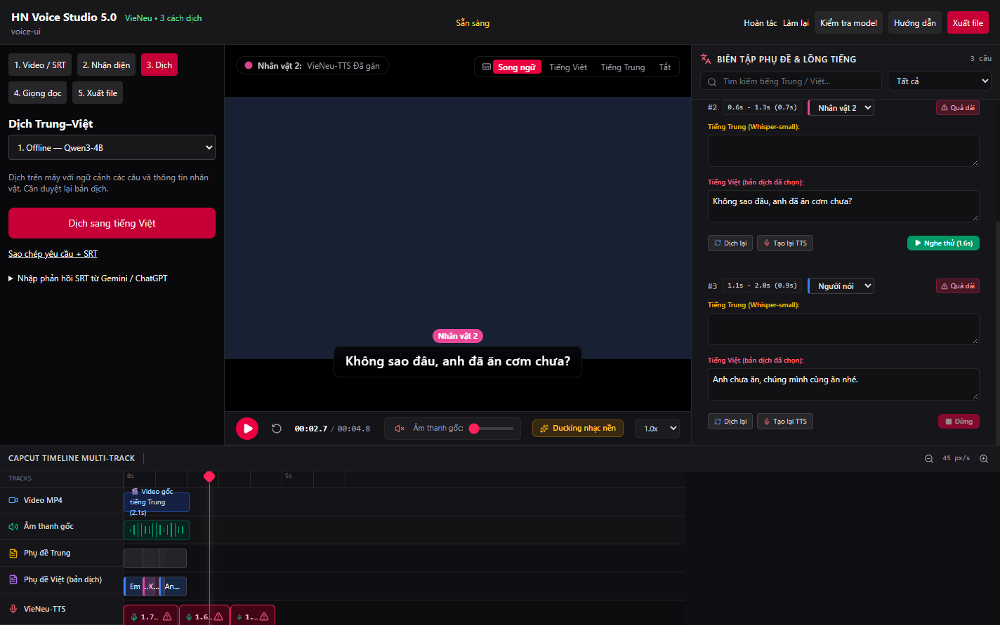

# Kiểm thử Windows — bản Electron 5.0.0

Ngày 22/10/2026. Kiểm thử EXE Windows đã đóng gói; không chỉ chạy bản phát triển.

| Hạng mục | Kết quả |
|---|---|
| Electron thật | Version 5.0.0; một cửa sổ chính, mở lần hai tập trung cửa sổ hiện có |
| Renderer | Node integration tắt, context isolation và sandbox bật |
| Worker | Cổng riêng, đối chiếu ID phiên; dừng sau khi đóng ứng dụng |
| ASR từ MP4 Trung | Qua trên video fixture tổng hợp |
| OCR phụ đề trên hình | Đúng ba câu fixture; ba lần OCR, bỏ qua khung lặp |
| Offline Qwen3 | Giữ đủ câu và ID, mẫu vợ chồng xưng anh/em; 50.66 giây cho ba câu trong lượt thử |
| VieNeu thật | Hai giọng Hải Đăng/Mai Anh; không cắt câu và không chồng thời gian |
| Cache giọng | Lượt ba câu 0.53 giây / cache 0.547 giây; không suy rộng thành tốc độ mọi video |
| Lịch giọng | 500 trường hợp ngẫu nhiên không chồng nhau |
| Nghe thử và phát video | Số nguồn âm thanh đang phát: [1, 1, 1] |
| Giọng qua cuối video | Video 2.08 giây, đồng hồ giọng tiếp tục tới 00:02.5 |
| Xuất qua nút Electron | WAV và SRT lưu thành công bằng sự kiện tải xuống của Electron |
| Lỗi JavaScript ở UI | 0 |
| Ba lựa chọn dịch | Có đủ Offline/Gemini/ChatGPT; cloud CDP đã kiểm thử trên backend dùng chung bản 4 và giữ nguyên trong bản 5 |

Bài thử dùng video/SRT tổng hợp. Không bảo đảm mọi nhận diện/tên riêng/bản dịch trên phim thực tế đều đúng. Cần duyệt kết quả. Chưa xuất MP4 lồng tiếng và chưa tự phân vai. Các thông tin đăng nhập Chrome, cache và đường dẫn cá nhân không phát hành.

